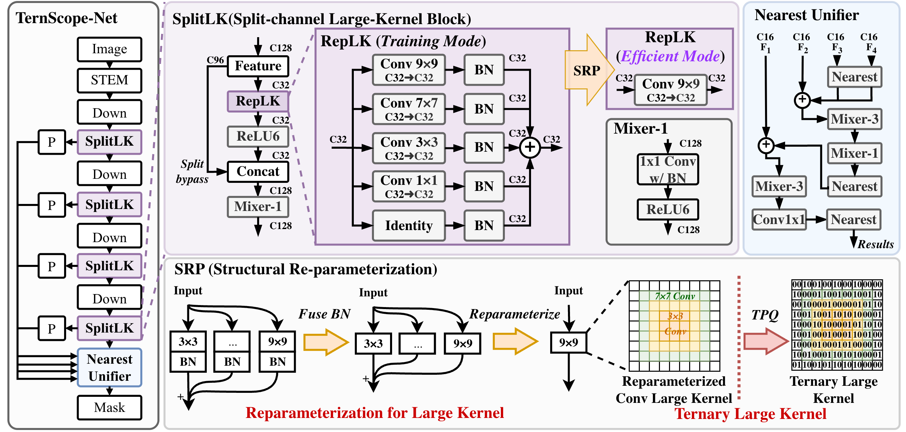
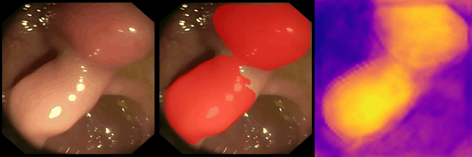
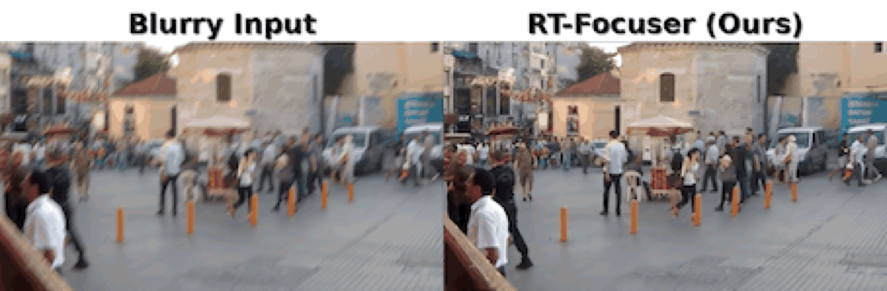
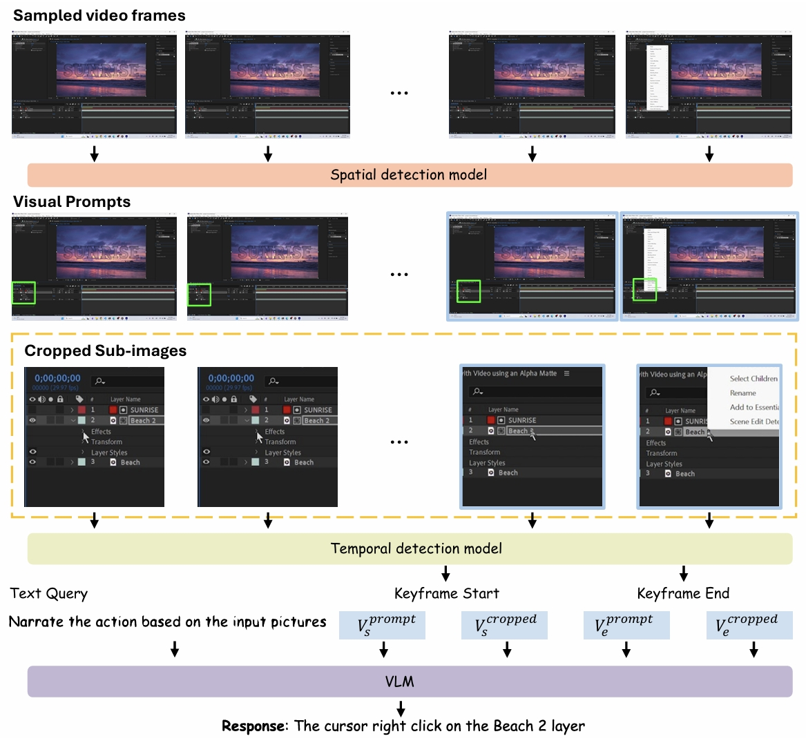

# Zhuoyu Wu

Reagan · 吴卓宇   /   PhD Student, Monash University

<!--  -->

Efficient intelligence, from algorithms to hardware.

I am a PhD student in the **CyPhi AI Lab at the Monash University**, supervised by **[Prof. Raphael Phan](https://www.monash.edu.my/it/staff/academic/prof-raphael-phan)**, and funded by Graduate Research Excellent Scholarship. Currently, I am also a visiting PhD student at **Peking University** under the guidance of **[Prof. Daquan Zhou](https://scholar.google.com/citations?user=DdCAbWwAAAAJ&hl=en)**.

Prior to Monash, I have worked on Efficient AI algorithm design as well as the SW/HW co-design under the guidance of **[Assoc. Prof. Dr. Zheng Wang](https://scholar.google.com/citations?user=j-zijKAAAAAJ&hl=en)** and **[Dr. Wenqi Fang](https://scholar.google.com/citations?user=lqtpolwAAAAJ&hl=en)** at Shenzhen Institutes of Advanced Technology, Chinese Academy of Sciences([SIAT, CAS](https://www.siat.ac.cn/)). I had a wonderful time there, collaborating with a group of talented individuals to deliver several key projects.

I care about making research reproducible and practical to deploy. As a member of [IAPR Technical Committee 22 on Reproducible Research in Pattern Recognition (TC22)](https://iapr-tc22.org/index.html), I welcome exchanges with researchers who share these interests and encourage interested colleagues to explore TC22’s activities.

If you are interested in any aspect of me, I am always open to discussions and academic collaborations. Feel free to reach out to me at — **zhuoyu.wu [at] monash.edu**

<ul class="affiliations" aria-label="Academic affiliations">
  <li>
    
    <strong>Monash University</strong>
    Current · PhD student
  </li>
  <li>
    
    <strong>SIAT, CAS</strong>
    Previous · Research collaboration
  </li>
  <li>
    
    <strong>Peking University</strong>
    Current · Visiting PhD student
  </li>
</ul>

---

<nav class="section-nav" aria-label="On this page"><a href="#research-interests">Research</a><a href="#news-and-updates">News</a><a href="/publications/">Publications</a><a href="#academic-service">Service</a><a href="#keynote-works">Projects</a></nav>

## Research Interests

- Efficient AI
- HW/SW co-design
- LLM
- AI for Science

---

## News and Updates

A compact research log: ⚙️ **efficient AI / hardware**, 🖥️ **GUI agents**, and 🎓 **personal milestones**.

Scroll for all updates · 2026–2023 ↓

### 2026

- ⚙️ **Oct 2026**: **TernScope: Model-Hardware Co-Design for Efficient Ternary Endoscopic Segmentation** is now available on arXiv, featuring W2A8 ternary quantization and an **88.46% reduction in compute-array area**. [[Preprint](https://arxiv.org/abs/2610.29617)] [[Code](https://github.com/ReaganWu/TernScope)]
- ⚙️ **Oct 2026**: **AGQ: Action-Guided Ultra-Low-Bit Quantization for Vision-Language-Action Models** is now available on arXiv, achieving **92.7% LIBERO success at W3** and up to **6.10× model compression**. [[Preprint](https://arxiv.org/abs/2610.33074)] [[Code](https://github.com/Qiuxu00/AGQ)]
- ⚙️ **Oct 2026**: Our paper, “**VAULT: A Secure FPGA Inference Accelerator for RRAM-Inspired Biomedical Edge Intelligence**,” has been accepted for an oral presentation at the IEEE International Conference on Microelectronics (**ICM 2026**). VAULT explores an RRAM-inspired approach to enhancing the security of FPGA-based biomedical image segmentation at the edge.
- ⚙️ **Aug 2026**: Two papers were accepted by **BMVC 2026**: **LiteUAV-DETR**, which studies scale-aware feature routing for real-time UAV detection, and **Motion-Equivariant Pseudo-Video Augmentation**, which targets video-style generalization from a single static polyp dataset. [[LiteUAV-DETR](https://scholar.google.com/citations?view_op=view_citation&hl=en&user=iAdEypoAAAAJ&sortby=pubdate&citation_for_view=iAdEypoAAAAJ:4DMP91E08xMC)] [[Pseudo-Video Augmentation](https://scholar.google.com/citations?view_op=view_citation&hl=en&user=iAdEypoAAAAJ&sortby=pubdate&citation_for_view=iAdEypoAAAAJ:aqlVkmm33-oC)]
- 🏅 **Aug 2026**: **DepthPolyp** received the **ICPR 2026 Reproducible Research in Pattern Recognition (RRPR) Badge**, following a separate positive peer-review evaluation of its reproducibility, transparency, code, and data availability. [[Badge Criteria](https://icpr2026.org/rrprBadges.html)] [[Paper](https://arxiv.org/abs/2605.16519)] [[Code](https://github.com/ReaganWu/DepthPolyp)]
- 🎓 **Aug 2026**: I was selected as a recipient of the **IEEE Computer Society WEIGD Student Support Fund**, as one of 502 selected applicants. [[Award](https://www.computer.org/volunteering/awards/scholarships/weigd-student-fund)]

- ⚙️ **Aug 2026**: **Lightweight Polyp Segmentation via a Gain-Aware Prediction-Space Recursive Controller** was accepted by **ICONIP 2026** as a **Poster** paper. The work introduces a compact, host-portable controller that recursively refines backbone logits with minimal deployment overhead. [[Preprint](https://arxiv.org/abs/2607.03062)] [[Code](https://github.com/tyui99/Gain-Aware-Prediction-Space-Recursive-Controller)]
- ⚙️ **Aug 2026**: **RoiMAM** was accepted by **APSIPA ASC 2026**. This work proposes a region-of-interest medical attention mechanism for efficient vision-language understanding, enabling compact yet effective medical visual question answering. [[Preprint](https://arxiv.org/abs/2605.15561)]
- ⚙️ **Aug 2026**: **RIGS-Refiner** was accepted by **APSIPA ASC 2026**. This work introduces a lightweight prediction-space refinement framework for robust colonoscopy polyp segmentation, improving segmentation quality with minimal computational overhead. [[Preprint](https://arxiv.org/abs/2607.03058)] [[Code](https://github.com/tyui99/RIGS-Refiner)]
- ⚙️ **Jul 2026**: **DepthPolyp in Practice** was accepted by the **Sixth Workshop on Reproducible Research in Pattern Recognition (RRPR 2026)**. This companion work expands the technical and reproducibility details of DepthPolyp and delivers a real-time iPhone inference and deployment framework. [[Program](https://tc22-team.github.io/rrpr2026/assets/files/draftProgramRRPR2026.pdf)]
- ⚙️ **Jun 2026**: **Edge-Segstar** was accepted by **Biomedical Signal Processing and Control (BSPC, Q1)**. This work explores bidirectional self-distillation to improve efficient medical segmentation models, aiming to better balance the trilemma among model size, accuracy, and inference speed. [[Paper](https://www.sciencedirect.com/science/article/pii/S1746809426013054?via%3Dihub)]
- ⚙️ **May 2026**: **RoiMAM** was released on **arXiv**. This work introduces a region-of-interest medical attention model for efficient vision-language understanding, focusing on lesion-relevant regions to improve medical visual question answering with a compact model. [[Preprint](https://arxiv.org/pdf/2605.15561)]
- ⚙️ **Apr 2026**: **DepthPolyp** was accepted by **ICPR 2026**. A pseudo-depth guided lightweight segmentation model for real-time colonoscopy, achieving **3.57M parameters**, **0.86 GMACs**, and over **180 FPS** on mobile devices. [[Paper](https://arxiv.org/abs/2605.16519)] [[Code](https://github.com/ReaganWu/DepthPolyp)] [[HF Model](https://huggingface.co/ReaganWZY/DepthPolyp)] [[HF Demo](https://huggingface.co/spaces/ReaganWZY/DepthPolyp-demo)]
- **⚙️ Jan 2026**: **EndoCaver** was accepted by **ICASSP 2026**. This work improves segmentation under fog, blur, and glare by connecting image restoration with the visual attention used for segmentation. [[Preprint](https://arxiv.org/abs/2601.22537)]

### 2025

- ⚙️ **Nov 2025**: **FLICKER** was accepted by **DATE 2026**. We reveal fine-grained sparsity in 3D Gaussian Splatting and design a contribution-aware reconfigurable accelerator for real-time 3DGS. [[Preprint](https://arxiv.org/abs/2603.01158)]
- ⚙️ **Oct 2025**: **TMU** was accepted by **IEEE TVLSI**. This work builds near-memory tensor manipulation capability for data-move-intensive, compute-light operators. [[Paper](https://ieeexplore.ieee.org/document/11224010/)]
- ⚙️ **Sep 2025**: **RT-Focuser** was accepted by **ICTA 2025** as an **Oral** paper. A lightweight real-time deblurring model for edge-side vision, exceeding **140 FPS** on mobile devices. [[Paper](https://arxiv.org/abs/2512.21975)] [[Code](https://github.com/ReaganWu/RT-Focuser)]
- 🎓 **Aug 2025**: I began my PhD journey at **Monash University**.
- 🖥️ **Jul 2025**: **GUI-Narrator** was accepted by **ACM MM 2025**. This work studies how to detect and caption computer GUI actions for multimodal agents. [[Paper](https://dl.acm.org/doi/10.1145/3746027.3755150)]
- ⚙️ **Apr 2025**: **AttenPU** was accepted by **GLSVLSI 2025**. An area-efficient attention processor with reconfigurable FP8 precision and bidirectional dataflow. [[Paper](https://dl.acm.org/doi/10.1145/3716368.3735201)]
- ⚙️ **Jan 2025**: **PR-KAN** was accepted by **ISCAS 2025** as an **Oral** paper. To the best of our knowledge, this is the first FPGA accelerator dedicated to **Kolmogorov-Arnold Networks (KANs)**. [[Paper](https://ieeexplore.ieee.org/document/11043217)]

### Earlier

- ⚙️ **Sep 2024**: **Fourier-LSTM** was accepted by **ICTA 2024**. We embed Fourier transforms into LSTM to improve DNA sequencing accuracy on portable devices. [[Paper](https://epapers2.org/icta2024/ESR/paper_details.php?paper_id=7110)]
- 🖥️ **May 2024**: **GUI Action Narrator** was publicly released. This work uses VLMs and pre-grounding to support GUI action understanding across platforms and applications. [[Paper](https://arxiv.org/abs/2406.13719)] [[Code](https://github.com/showlab/GUI-Narrator)]
- ⚙️ **Apr 2024**: **Harmonizing U-Nets** was accepted by ***Computers in Biology and Medicine*** (Q1, IF=7.7). A cascaded design with adaptive attention fusion for efficient low-quality OCT fluid segmentation. [[Paper](https://pubmed.ncbi.nlm.nih.gov/39368312/)]
- ⚙️ **Apr 2023**: **COMPACT** was presented at **DATE 2023**, focusing on precision-adjustable nonlinear activation acceleration. [[Paper](https://ieeexplore.ieee.org/document/10137019/)]

---

## Academic Service

### Technical Committee Member
IAPR TC22 · Reproducible Research in Pattern Recognition

### Reviewing & Programme Committees

- Journal:

  - Information Sciences (Q1) -- Reviewer
  - Biomedical Signal Processing and Control (Q1) -- Reviewer
  - MEDICAL & BIOLOGICAL ENGINEERING & COMPUTING (Q2) -- Reviewer
  - Frontiers in Digital Health (Q1) -- Reviewer
  - Frontiers in Cell and Developmental Biology (Q1) -- Reviewer
  - Applied Computational Intelligence and Soft Computing -- Reviewer
- Conference:

  - ISCAS 2027 -- Reviewer
  - ICASSP 2027 -- Reviewer
  - BMVC 2026 -- Reviewer
  - RRPR 2026 --Programme Committee
  - IJCNN 2027 -- Reviewer
  - ACMMM Dataset Track 2026 -- Programme Committee Member
  - ACMMM 2026 -- Reviewer
  - MICCAI 2026 -- Reviewer
  - WCCI 2026 -- Reviewer
  - ICASSP 2026 -- Reviewer
  - BMVC 2025 -- Reviewer
  - IJCNN 2025 -- Reviewer

---

## Keynote Works

Selected projects in efficient models, practical deployment, and multimodal understanding.

  <section class="project-card" aria-labelledby="project-ternscope">
    
    
Architecture figure from the project repository

    
Model–hardware co-design

    <h3 id="project-ternscope"><a href="https://github.com/ReaganWu/TernScope">TernScope</a></h3>
    
A ternary endoscopic segmentation model co-designed with an accelerator, connecting low-bit inference with efficient hardware.

    
<a href="https://github.com/ReaganWu/TernScope" aria-label="TernScope on GitHub">GitHub ↗</a><a class="project-paper" href="https://arxiv.org/abs/2610.29617" aria-label="TernScope paper">Paper ↗</a>

  </section>
  <section class="project-card" aria-labelledby="project-depthpolyp">
    
    
Still from the repository segmentation demo

    
Medical vision & deployment

    <h3 id="project-depthpolyp"><a href="https://github.com/ReaganWu/DepthPolyp">DepthPolyp</a></h3>
    
Lightweight colonoscopy segmentation with pseudo-depth guidance, including ONNX inference and an open-source iPhone Core ML demo.

    
<a href="https://github.com/ReaganWu/DepthPolyp" aria-label="DepthPolyp on GitHub">GitHub ↗</a><a class="project-paper" href="https://arxiv.org/abs/2605.16519" aria-label="DepthPolyp paper">Paper ↗</a>

  </section>
  <section class="project-card" aria-labelledby="project-rt-focuser">
    
    
Still from the repository deblurring demo

    
Real-time edge vision

    <h3 id="project-rt-focuser"><a href="https://github.com/ReaganWu/RT-Focuser">RT-Focuser</a></h3>
    
A lightweight image deblurring model for real-time edge deployment, with training, inference, and mobile deployment resources.

    
<a href="https://github.com/ReaganWu/RT-Focuser" aria-label="RT-Focuser on GitHub">GitHub ↗</a><a class="project-paper" href="https://arxiv.org/abs/2512.21975" aria-label="RT-Focuser paper">Paper ↗</a>

  </section>
  <section class="project-card" aria-labelledby="project-gui-narrator">
    
    
Pipeline figure from the project repository

    
Multimodal GUI understanding

    <h3 id="project-gui-narrator"><a href="https://github.com/showlab/GUI-Narrator">GUI-Narrator</a></h3>
    
A GUI action captioning framework and the Act2Cap dataset, using cursor detection and keyframe extraction to interpret on-screen actions.

    
<a href="https://github.com/showlab/GUI-Narrator" aria-label="GUI-Narrator on GitHub">GitHub ↗</a><a class="project-paper" href="https://arxiv.org/abs/2406.13719" aria-label="GUI-Narrator paper">Paper ↗</a>

  </section>

 

<!--
<blockquote class="twitter-tweet">
Thrilled to be an AAAI-UC Scholar at <a href="https://twitter.com/hashtag/AAAI24?src=hash&ref_src=twsrc%5Etfw">#AAAI24</a>, thanks to <a href="https://twitter.com/hashtag/AAAI?src=hash&ref_src=twsrc%5Etfw">#AAAI</a> & <a href="https://twitter.com/hashtag/GoogleExploreCSR?src=hash&ref_src=twsrc%5Etfw">#GoogleExploreCSR</a> for the sponsorship. Grateful for the knowledge gained and new friendships formed.  Wonderful trip in Vancouver. Looking forward to staying connected with all.<a href="https://twitter.com/hashtag/AAAI24?src=hash&ref_src=twsrc%5Etfw">#AAAI24</a> <a href="https://twitter.com/hashtag/Vancouver?src=hash&ref_src=twsrc%5Etfw">#Vancouver</a> <a href="https://twitter.com/hashtag/GoogleExploreCSR?src=hash&ref_src=twsrc%5Etfw">#GoogleExploreCSR</a> <a href="https://t.co/wUQUp8XlSM">pic.twitter.com/wUQUp8XlSM</a>
— Hanlin CAI (seeking a PhD position 2025) (@lancecai2002) <a href="https://twitter.com/lancecai2002/status/1762210025173344260?ref_src=twsrc%5Etfw">February 26, 2024</a></blockquote> 
 -->

<!-- Statable visitor map -->

  

